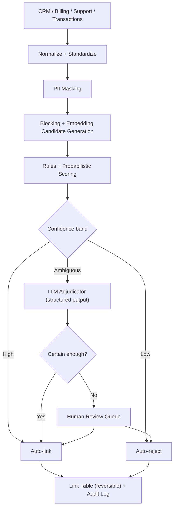

# IdentityIQ

**Explainable customer identity resolution for banking KYC: match the same customer across CRM, billing, and transaction systems, with a reason and an audit trail for every decision.**


> **Status: in development.** See [Status](#status). Nothing is claimed as working unless checked off there. Result numbers appear only after the benchmark has been run. All data in this repository is **synthetic**.

<!-- Add a 60-second demo GIF: ambiguous pair -> LLM adjudication -> explanation -> review queue -->


---

## TL;DR

| | |
|---|---|
| **Problem** | One customer exists as 3 to 5 different records across CRM, billing, support, and transaction systems. Names, addresses, and phones disagree. |
| **Solution** | A tiered matching pipeline: rules for obvious matches, probabilistic scoring for most, and an LLM **only for the ambiguous band**, each decision with a structured explanation. |
| **Key idea** | In banking, a **false merge is far worse than a missed match** (two people's data combined). The system is tuned for precision, and every merge is reversible. |
| **Proof** | Benchmarked on synthetic records with known ground truth, including adversarial cases. See [Results](#results). |

## Why this exists

Failed KYC verification, duplicate accounts, wrong customer communication, and inconsistent reporting all trace back to the same cause: the bank cannot say which records belong to the same person. Existing tools (Splink, Zingg) match well on scores but offer little in the way of per-decision explanations that a compliance officer can read and sign off.

## What it does

1. **Ingests** records from multiple source systems and normalizes them (names, addresses, phones, dates, IDs).
2. **Masks PII** before any text reaches an LLM (tokenization, with a local-model option).
3. **Generates candidate pairs** with blocking plus embedding similarity (avoids comparing every record to every other).
4. **Scores pairs** with deterministic rules and a probabilistic model.
5. **Routes by confidence:**
   - High confidence: auto-link.
   - Low confidence: auto-reject.
   - Ambiguous band: LLM adjudicator returns a **structured verdict with cited evidence**.
6. **Low-certainty verdicts go to a human review queue.** Nothing ambiguous is merged automatically.
7. **Writes every decision to an audit log** and keeps merges **reversible** (link table, not destructive overwrite).

### Example decision (illustrative format)

```json
{
  "pair": ["crm:88123", "billing:4471"],
  "decision": "match",
  "tier": "llm_adjudicated",
  "confidence": 0.0,
  "evidence": [
    {"field": "name", "detail": "'Rob Mehta' vs 'Robert Mehta': nickname variant"},
    {"field": "dob", "detail": "exact match"},
    {"field": "phone", "detail": "same number, different formatting"}
  ],
  "conflicts": [
    {"field": "address", "detail": "differs; billing address is 14 months older"}
  ],
  "requires_human_review": false,
  "reversible": true
}
```

The LLM may not return a `match` without at least two independent evidence items. Conflicts must be listed, never hidden.

## Architecture



### Design decisions

| Decision | Why |
|---|---|
| Tiered pipeline, LLM only for the ambiguous band | LLM-on-every-pair is slow, expensive, and inconsistent. Most pairs are easy. |
| Precision-first thresholds | A false merge exposes one customer's data to another and corrupts compliance records. |
| Link table, not destructive merge | Any merge can be undone. Required for audit and error correction. |
| Structured verdicts with required evidence | Gives compliance a readable reason. Prevents unsupported "looks the same" answers. |
| PII masking before LLM calls | Customer data should not leave the trust boundary in raw form. |
| Hard negatives in the benchmark | Family members, same-name strangers, and shared addresses are where real systems fail. |

## Evaluation

Ground truth comes from a **synthetic generator**: start with clean golden customers, then produce per-system records with realistic corruption (typos, nicknames, transliteration, swapped name order, address changes, outdated phones, missing fields, date-format differences). The golden ID is the label.

| Level | What is measured |
|---|---|
| Matching quality | Precision, recall, F1 on pairs and on clusters |
| **False-merge rate** | Reported separately; the primary safety metric |
| Tier efficiency | % resolved by rules vs. probabilistic vs. LLM vs. human |
| Adjudicator quality | Accuracy, evidence faithfulness (do cited facts exist in the records?) |
| Calibration | Does stated confidence match observed accuracy? |
| Cost and speed | Cost per 1,000 records, p95 latency, LLM calls per resolved pair |

**Hard-negative test sets:** same name and different people, twins/siblings sharing address and surname, parent and child with the same name, shared household phones, and legitimately changed names or addresses.

## Results

Filled in only after the benchmark is run. No numbers are claimed before that.

| Metric | Rules only | Probabilistic only | LLM on all pairs | IdentityIQ |
|---|---|---|---|---|
| Precision | TBD | TBD | TBD | TBD |
| Recall | TBD | TBD | TBD | TBD |
| F1 | TBD | TBD | TBD | TBD |
| **False-merge rate** | TBD | TBD | TBD | TBD |
| % pairs sent to LLM | 0% | 0% | 100% | TBD |
| Cost per 1,000 records | TBD | TBD | TBD | TBD |
| Human-review rate | TBD | TBD | TBD | TBD |

If the tiered design does not beat the probabilistic-only baseline on false-merge rate at comparable recall, the LLM tier is not justified and the README will say so.

## How it compares

| Tool | Strength | Gap IdentityIQ targets |
|---|---|---|
| Splink | Strong open-source probabilistic matching at scale | Scores only; no readable per-decision rationale or adjudication of ambiguous cases |
| Zingg | ML-based matching with active learning | Same: limited explainability and review workflow |
| Commercial MDM suites | Full platforms | Expensive, opaque, heavy to adopt |

IdentityIQ does not replace a scoring engine. The base tier can use Splink. The contribution is **LLM adjudication for the ambiguous band, with explanations, a review queue, reversible merges, and an audit trail.**

## Tech stack

| Layer | Choice |
|---|---|
| Normalization | Python, `usaddress`/`libpostal`, `phonenumbers`, `rapidfuzz` |
| Blocking and candidates | Multi-key blocking + embeddings in pgvector |
| Scoring | Deterministic rules + probabilistic (Fellegi-Sunter via Splink) |
| Adjudicator | LangGraph, structured output (Pydantic), provider-agnostic LLM interface |
| PII protection | Tokenization/masking layer, optional local model |
| Storage | PostgreSQL (records, link table, audit log, review queue) |
| API and review UI | FastAPI, Streamlit |
| Synthetic data | Faker + custom corruption engine |
| Observability | OpenTelemetry + Langfuse |
| Quality | pytest, ruff, mypy, GitHub Actions |
| Packaging | Docker Compose |

## Security and compliance

- **Synthetic data only** in this repository. No real customer data.
- PII masked before LLM calls; local-model path for stricter environments.
- Role-based access on the review queue; reviewer identity recorded.
- **Immutable audit log:** inputs, tier, evidence, verdict, model version, reviewer, timestamp.
- Reversible merges with unmerge support.
- Prompt-injection defense: record fields are delimited as data, never instructions (a name field can contain malicious text).
- Per-run limits on tokens, calls, and cost.
- This is decision support. It is **not** a certified compliance system.

## Quick start

```bash
git clone https://github.com/adiii-dhande/identityiq.git
cd identityiq
uv sync
cp .env.example .env
docker compose up -d db
python -m identityiq.synth --customers 10000 --out data/synthetic
python -m identityiq.resolve --input data/synthetic --out out/links
python -m identityiq.eval --truth data/synthetic/truth.parquet --links out/links --report out/report.md
streamlit run review_ui/app.py
```

## Project structure

```text
identityiq/
├── identityiq/
│   ├── normalize/     # names, addresses, phones, dates
│   ├── privacy/       # PII masking/tokenization
│   ├── blocking/      # blocking keys, embedding candidates
│   ├── scoring/       # rules, probabilistic model
│   ├── adjudicator/   # LangGraph agent, schemas, prompts
│   ├── linking/       # link table, unmerge, audit log
│   ├── synth/         # synthetic data + corruption engine
│   ├── eval/          # metrics, hard-negative suites, calibration
│   └── api/           # FastAPI service
├── review_ui/         # Streamlit review queue
├── tests/
├── docs/              # architecture, ADRs, failures.md, demo.gif
├── .github/workflows/
└── pyproject.toml
```

## Status

| Component | Status |
|---|---|
| Synthetic data generator with corruption | ⬜ Planned |
| Normalization layer | ⬜ Planned |
| Blocking + candidate generation | ⬜ Planned |
| Rules + probabilistic scoring | ⬜ Planned |
| LLM adjudicator (structured, evidence-required) | ⬜ Planned |
| Link table, unmerge, audit log | ⬜ Planned |
| Review queue UI | ⬜ Planned |
| Benchmark + hard-negative suites | ⬜ Planned |
| Calibration analysis | ⬜ Planned |

Replace ⬜ with ✅ only when tested.

## Known limitations

- Synthetic corruption does not cover every real-world data quality problem.
- Name matching across scripts and cultures is hard; coverage is limited to the transliteration cases tested.
- LLM adjudication adds latency and cost; it is applied only to the ambiguous band.
- Embedding-based candidate generation can miss pairs with very different surface forms.
- Not a replacement for regulated KYC/AML tooling or legal review.

## Roadmap

- [ ] Active learning: reviewer decisions retrain scoring thresholds
- [ ] Household and relationship graph (distinguish family from duplicates)
- [ ] Multilingual and transliteration support
- [ ] Incremental (streaming) resolution for new records
- [ ] Drift monitoring on match rates and review rates

## Engineering notes (for reviewers)

- **Why the false-merge rate is the headline metric:** F1 hides the asymmetry. One wrong merge costs more than many missed matches.
- **Why calibration matters:** auto-link thresholds are only safe if stated confidence matches real accuracy.
- **Why a synthetic generator:** real banking data cannot be shared, and generated corruption gives exact labels.
- **Failure cases are documented** in `docs/failures.md`.

## License and author

MIT License.

**Aditya Dhande** · [LinkedIn](https://linkedin.com/in/aditya-dhande-data) · [GitHub](https://github.com/adiii-dhande)
